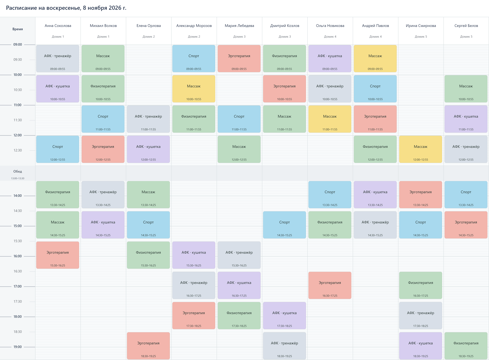

# Расписание процедур

Оконное приложение для Windows: пациенты и домики, расписания по дням, цветные блоки процедур и экспорт готового расписания в PNG. Работает локально, без браузера и подключения к интернету.



## Скачать и запустить

1. Откройте [последний релиз](https://github.com/Surprisemm/procedure-planner/releases/latest).
2. Скачайте **Procedure-Planner-1.0.1-Windows-x64.exe** из раздела Assets.
3. Запустите файл двойным щелчком. Установка не требуется.

Поддерживается Windows 10/11 x64. Для работы не нужны Node.js и дополнительные файлы рядом с EXE. При первом запуске переносимая сборка распаковывает необходимые компоненты во временную папку.

EXE пока не подписан цифровым сертификатом. Windows SmartScreen может показать предупреждение о неизвестном издателе. Для проверки загруженного файла в релизе опубликована контрольная сумма SHA-256.

## Возможности

- Несколько именованных расписаний с отдельными списками пациентов и датами заезда. Новый заезд по умолчанию — 28 календарных дней.
- Вкладки дней, копирование целого дня и перенос отдельных назначений между датами.
- Общий список пациентов внутри расписания; участие в каждом дне включается галочкой.
- Общая библиотека процедур, drag and drop на временную сетку, изменение длительности краями блока.
- Общий справочник инструкторов во вкладке рядом с пациентами, добавление по одному или списком. Выбор инструктора у заготовки процедуры.
- Кнопка автозаполнения с диалогом-заготовкой; алгоритм готовится к разработке. Флаг блокировки назначений сохраняется в проекте.
- Сетка с шагом 5 минут и автоматическое расширение в пределах календарных суток. При добавлении нового вида процедуры длительность по умолчанию — 50 минут; её можно изменить в форме создания или инспекторе.
- Инспектор: текст, шрифт, размер, жирный, курсив, выравнивание и цвета. Сохраняемые образцы цветов.
- Флажок в свойствах заготовки применяет изменяемые настройки ко всем её назначениям текущего дня; без флажка меняется только заготовка.
- Обед 13:00–13:30, консилиум и собственные полосы периодов. Полосы служат визуальными отметками и редактируются в инспекторе.
- Экспорт PNG с выбором времени, разрешения и разбиения колонок; скруглённые блоки и заголовок с датой.
- Локальное автосохранение, резервная копия, отмена и повтор действий. Проекты можно сохранять и открывать в JSON.
- Встроенное обучение из шести коротких страниц.

## Данные

Автосохранение хранится в `%APPDATA%\Расписание процедур`. Файл EXE не содержит пользовательских расписаний. Чтобы перенести данные на другой компьютер, используйте **«Сохранить проект»**, затем **«Открыть»**.

Примеры в приложении и на изображении содержат вымышленные данные. Итоговый формат расписания — **PNG**.

## Разработка

Используются Electron, JavaScript, HTML/CSS и Canvas. Интерфейс без внешнего UI-фреймворка. Нужны Node.js 24 и npm.

```powershell
npm ci
npm start
```

Проверки:

```powershell
npm test
```

Сборка Windows x64:

```powershell
npm run build:desktop
npm run build:portable
```

Готовый единый EXE появляется в `release/Расписание процедур <версия>.exe`. Сборка требует подключения к интернету для загрузки инструментов упаковки.

## Структура

- `app.js`, `styles.css`, `index.html` — интерфейс.
- `domain.mjs` — модель расписаний, пациенты, дни и размещение процедур.
- `presentation.mjs`, `export.mjs` — оформление и PNG.
- `color-picker.mjs`, `text-editors.mjs`, `time-picker.mjs`, `drag-scroll.mjs` — элементы редактора.
- `desktop/` — оконная оболочка, файловые операции и проверки интерфейса.
- `scripts/` — сборка и подготовка иллюстраций обучения.
- `tests/` — автоматические проверки модели и сохранения.
- `assets/tutorial/` — встроенные изображения обучения.

Готовые бинарные файлы размещаются в Releases. Локальные автосохранения, зависимости, временные файлы и история рабочих скриншотов не входят в репозиторий.

Текущее состояние разработки и принятые решения: [PROJECT_STATE.md](PROJECT_STATE.md). Оконные проверки запускаются отдельным модулем `desktop/smoke.cjs`; основной файл запуска содержит только код приложения.
